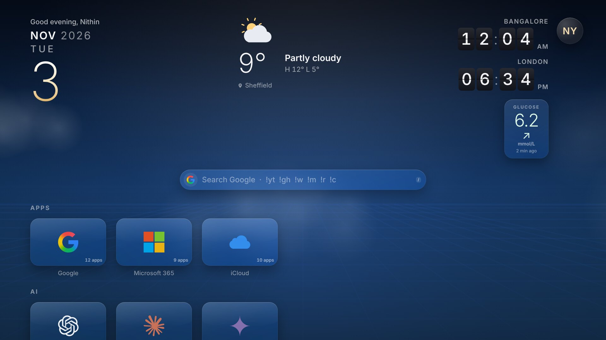
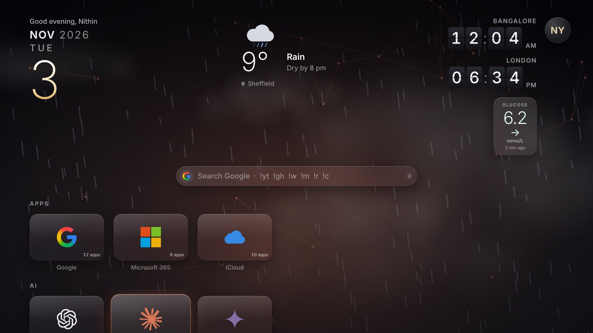
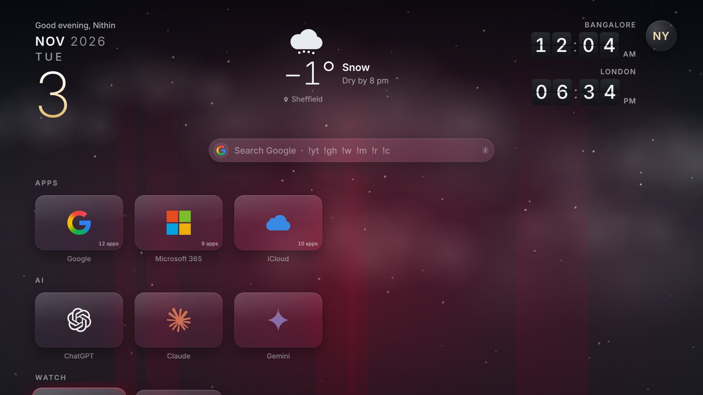
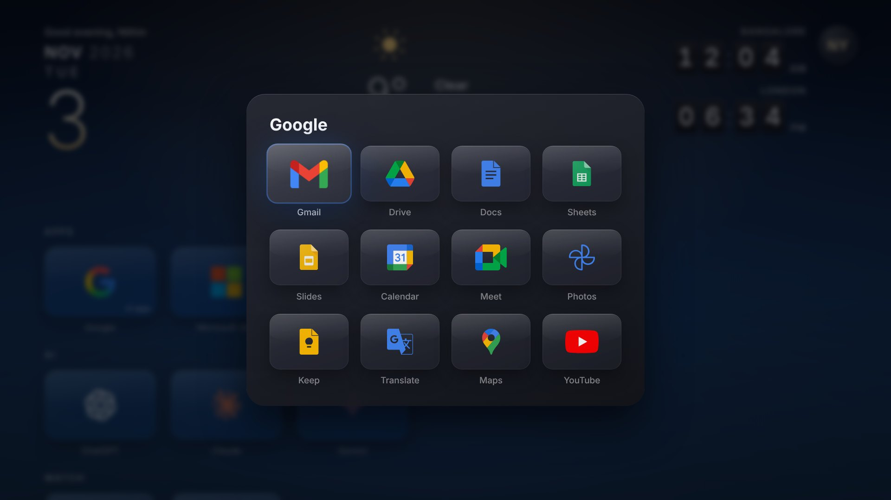
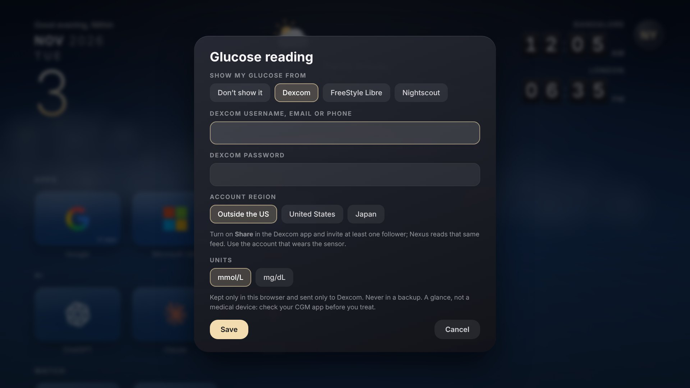
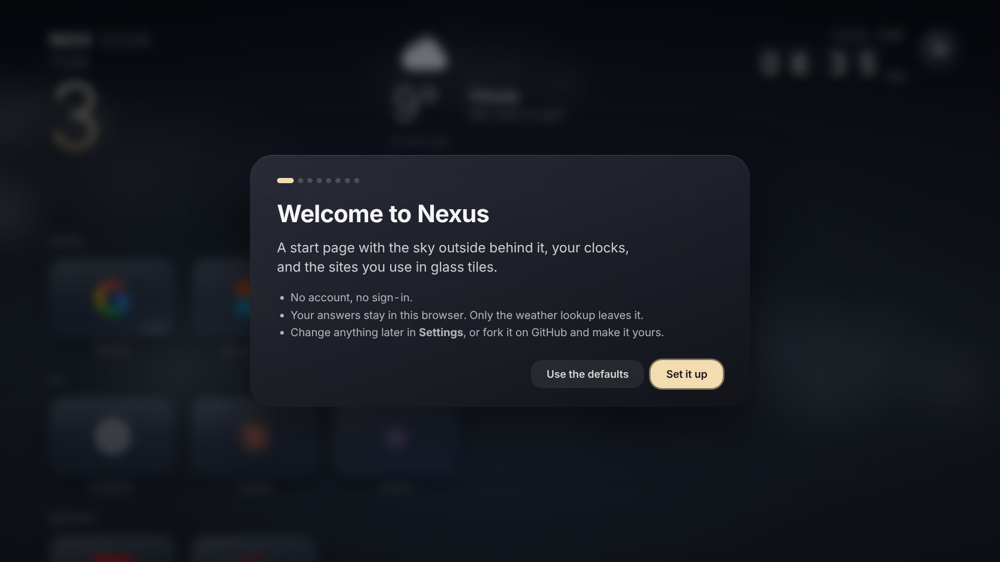
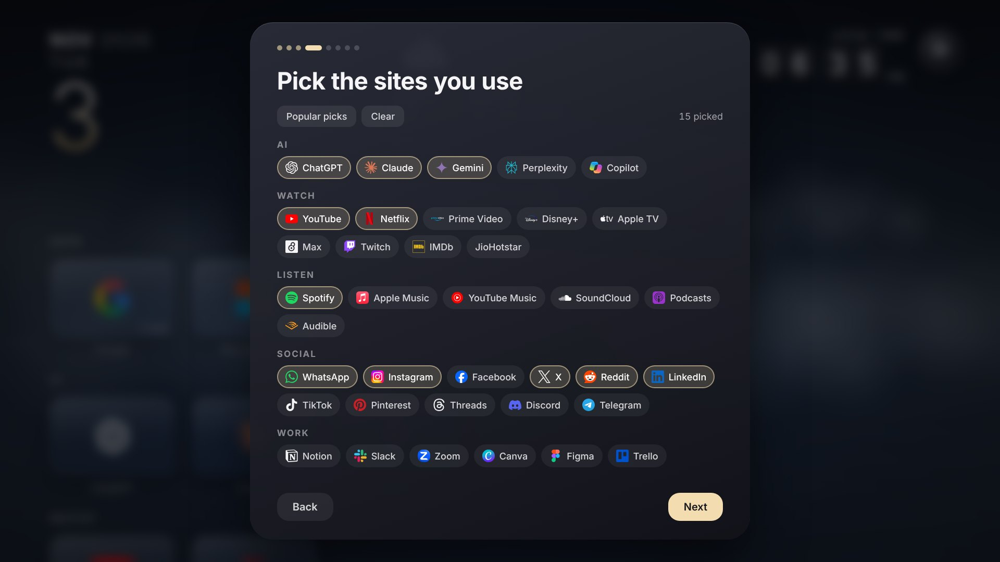
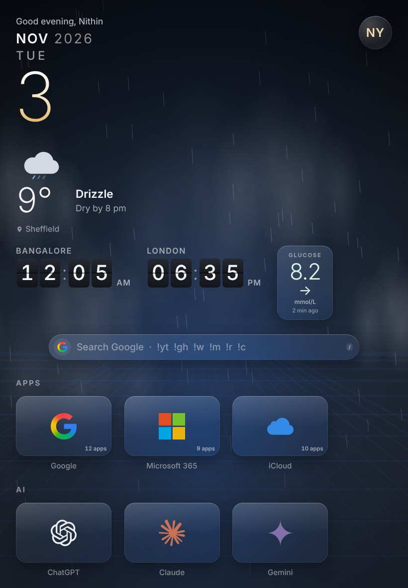

# Nexus

**A start page that feels like a TV home screen.** The sky outside plays behind it (rain, snow, fog, storms,
stars, sunrise and sunset), your world clocks flip, and the sites you use sit in glass tiles. Mouse, trackpad,
touch, keyboard, or full-screen TV mode.

**Try it:** https://nithinyadavg.github.io/nexus-start/



## Watch it in action

<!-- Drop the screen recording here: edit this file on GitHub (pencil icon) and drag the .mp4/.mov onto this line. -->
*Screen recording coming soon.*

## A closer look

| | |
|---|---|
|  |  |
| **The sky is the weather outside.** Rain at night, with the tile you're on lighting it. | **Snow, fog, storms, sunrise and sunset**, all drawn live and kept light on battery. |
|  |  |
| **Suites in one tile.** Google, Microsoft 365 and iCloud open their whole app family. | **Your glucose, if you want it.** Dexcom Share or Nightscout, read straight from your browser. |
|  |  |
| **A one-minute setup** on the first visit. No account. | **Pick the sites you use** from 69 of the most visited, grouped by what they're for. |

<p align="center"><br><em>On an iPad in portrait.</em></p>

*The glucose numbers in these pictures are made up (the page's `?glucose=112` preview).*

## What it does

- **No account, no sign-in, no tracking.** A one-minute setup asks your name, your city, your clocks and the sites
  you use; the answers stay in your browser. The only thing that leaves it is the weather lookup.
- **Suites in one tile.** Google, Microsoft 365 and iCloud each open a panel with all their apps, like the app grid
  in Google's corner.
- **It learns what you use** — in your browser only. After a few visits a *Most used* row appears, ranked by how
  often and how recently you open each site.
- **Search like a launcher.** Start typing anywhere. `Tab` switches engine (Google, DuckDuckGo, Bing, Brave, Ecosia,
  Startpage). `!yt`, `!gh`, `!w`, `!m`, `!r`, `!c`, `!g` search YouTube, GitHub, Wikipedia, Maps, Reddit, Claude or
  ChatGPT instead. A web address goes straight there.
- **Your glucose, optional.** A glass card under the clocks shows your latest CGM reading, its trend arrow and how
  old it is, and beside it how it has been flowing: a smooth line over the last 3, 6, 12 or 24 hours on the in-range
  band, gold above it and red below. Turn it on in the setup or **Settings → Glucose reading**.
  [Dexcom](https://www.dexcom.com) works directly through Dexcom Share. **FreeStyle Libre** comes in through
  [Nightscout](https://nightscout.github.io), because Abbott's LibreLinkUp servers refuse requests from web pages;
  Nightscout also covers Medtronic, Eversense and anything xDrip+ or Juggluco can read. The sign-in stays in your
  browser, goes only to Dexcom or your own Nightscout, and is never put in a backup. It's a glance, not a medical
  device: check your CGM app before you treat. To show it without real numbers (for a demo), add
  `?glucose=112&trend=FortyFiveUp` to the address.
- **Back up and move.** Settings → *Back up my setup* saves a small `.json` you can restore in any browser.

| Keys | |
|---|---|
| type anything | search |
| `/` | jump to search · `Tab` engine · `Esc` back to the tiles |
| `←` `↑` `→` `↓` · `Enter` | move · open (`⌘`/`Ctrl`-click for a new tab) |
| `⇧F` | TV mode (full screen; the pointer hides when still) |

## Make it your start page

- **As your new tab (Chrome, Edge, Brave):** download this repo (Code → Download ZIP) and unzip it, open
  `chrome://extensions`, turn on **Developer mode**, **Load unpacked**, and pick the folder. Every new tab is Nexus.
- **As your home page:** Chrome → Settings → On start-up → *Open a specific page* → the address above.
  Safari → Settings → General → Homepage. Firefox → Settings → Home → Custom URLs.

## Make it yours (fork it)

Everything it can offer lives in **`catalog.js`**: categories, sites, suites, search engines and `!` shortcuts. Add a
site with an `id`, `name`, `url`, an `icon` from `icons.js` (or none, to show its name) and a `color` for the light it
casts. The setup picks it up by itself.

To add logos, `icons.js` is generated from [theSVG](https://github.com/glincker/thesvg) and [Lucide](https://lucide.dev):

```bash
npm pack @thesvg/icons lucide-static && for f in *.tgz; do mkdir -p "${f%.tgz}" && tar xzf "$f" -C "${f%.tgz}"; done
node make-icons.js thesvg-icons-*/package/dist lucide-static-*/package/icons > icons.js
```

Publish your fork with **Settings → Pages → Deploy from a branch → `main` / root**. No build step: it's plain HTML,
CSS and JavaScript, and works opened straight from disk too. Please swap the phoenix (`sign.png`, `icon128.png`) for
your own mark.

## How it was decided

- **What's in the catalogue.** The popular picks follow [Similarweb's most-visited sites](https://en.wikipedia.org/wiki/List_of_most-visited_websites)
  (August 2026): Google, YouTube, Facebook, Instagram, ChatGPT, X, Reddit, WhatsApp, Wikipedia, Amazon, Gemini,
  LinkedIn, Netflix, Microsoft 365, Outlook, Claude, GitHub… leaving out search engines (they're in the search bar),
  adult and gambling sites, and portals.
- **What a start page needs.** The ones people keep ([awesome-startpage](https://github.com/jnmcfly/awesome-startpage):
  Bonjourr, Casca, Dashy, Homepage, KeyJump, Tilde) share search first, sites grouped by what they're for, one
  consistent look, and keyboard-first use. Nexus adds a pointer that never fights the keyboard: hover moves focus, but
  only when the mouse really moved.
- **Logos.** [theSVG](https://github.com/glincker/thesvg) has 7,600+ brands in full colour with dark-mode variants
  (MIT, most logos CC0), against Simple Icons' single colour or svgl's ~400 ([comparison](https://dev.to/thegdsks/i-tested-every-open-source-brand-svg-library-so-you-dont-have-to-2026-edition-3jcc)).
  Logos that vanish on dark glass are drawn in white.
- **Privacy by construction.** No analytics, no cookies, no server. Location comes from your connection
  ([GeoJS](https://www.geojs.io)) or a city you pick ([Open-Meteo geocoding](https://open-meteo.com/en/docs/geocoding-api));
  weather from [Open-Meteo](https://open-meteo.com). The optional glucose card talks only to Dexcom Share (the feed
  the Dexcom Follow app uses, as documented by [pydexcom](https://github.com/gagebenne/pydexcom)) or to your own
  Nightscout's `/api/v1/entries` with a read-only token.

## Credits

Made by [Nithin Yadav Gopinath](https://nithinyadavg.me). Logos: theSVG (MIT; logos CC0 unless noted), owned by their
brands. Glyphs: Lucide (ISC). Font: Inter (SIL OFL). MIT licence.
